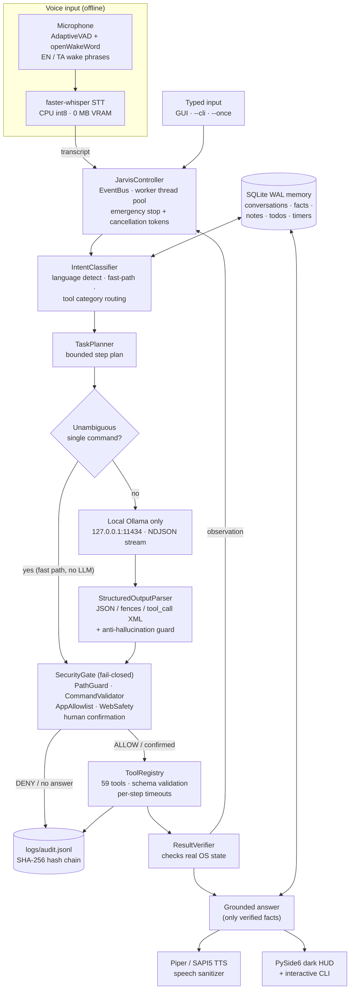

# JARVIS PERSONAL AI

[](https://github.com/ghabilaadithyaa624/my-jarvis-agent/actions/workflows/ci.yml)
[](LICENSE)
[](https://www.python.org/downloads/)
[](#limitations--known-issues)

**A 100% local voice operator and desktop agent for Windows 11 — it opens your apps, finds your files, reads your documents and checks your machine, without a single byte leaving your laptop.**

What makes it different:

- **Zero cloud, by design.** The only network endpoint the agent may talk to is local Ollama at `127.0.0.1:11434`; the URL is validated as loopback and environment proxies are explicitly disabled. No cloud SDK, no API key, no telemetry, no fallback.
- **Built around a 6 GB VRAM budget.** Defaults are tuned so a single 7B Q4 model fits in an RTX 3050 laptop GPU: STT runs `int8` on the CPU (0 MB VRAM), screenshots and the HUD share the OS reserve, and `num_ctx=4096` keeps the KV cache small.
- **A hash-chained audit log and confirmation gates.** Every tool call goes through one `SecurityGate`; deletes, overwrites, process kills, installs and sensitive web pages require an explicit human "yes", and every decision is appended to a SHA-256 hash-chained `audit.jsonl` you can verify from the GUI or CLI.
- **English and Tamil voice.** Offline wake words (*"Hey Jarvis"* / *"ஜார்விஸ்"*), offline faster-whisper recognition and offline Piper neural voices, with a built-in Windows SAPI5 fallback before you download any model.

---

## Demo

> **Placeholder — no faked media.** The recordings below are produced by the maintainer on the target
> machine (see [`docs/README.md`](docs/README.md) for exactly what to capture). Until they exist, this
> section intentionally shows links rather than a mock-up screenshot.

| What | File |
|---|---|
| 15-second end-to-end demo (wake word → command → confirmation → verified result) | `docs/demo.gif` |
| PySide6 dark HUD, 1200×700 | `docs/screenshot-hud.png` |

```markdown


```

---

## Architecture



Read [`ARCHITECTURE.md`](ARCHITECTURE.md) for the full VRAM budget, the 9-stage execution pipeline, the
security model and the verification matrix.

---

## Quick start

### 0. Prerequisites

- **Windows 11** with **Python 3.10+** (`python --version`)
- **Ollama for Windows** installed and running locally (`ollama --version`)
- At least one local chat model for your GPU:

  ```powershell
  ollama pull qwen2.5:7b     # ~4.7 GB — fits cleanly in 6 GB VRAM
  ollama pull qwen2.5:3b     # ~1.9 GB — optional, ideal when Blender is open
  ```

### 1. Core install first (no GUI, no microphone, any OS)

```powershell
pip install -e .
python -m jarvis --doctor      # hardware, Ollama, voices and optional packages
python -m jarvis --cli         # terminal operator
```

The core is five packages (`httpx`, `pydantic`, `psutil`, `PyYAML`, `numpy`) and already gives you the
full agent: intent routing, planning, the security gate, 59 tools, SQLite memory and the audit log.
Anything missing later is reported politely with the exact extra to install — never as a traceback:

```text
JARVIS could not start because an optional component is missing: the PySide6 desktop HUD
  missing Python module : PySide6
  provided by the extra : gui
Install that feature with: pip install -e ".[gui]"   (or ".[full]" for everything)
```

### 2. Full Windows 11 install (desktop HUD + offline voice)

```powershell
pip install -e ".[full]"                 # gui + voice + windows + documents + browser
python -m playwright install chromium    # optional: interactive browser automation
```

Or let the setup wizard create `.venv` and install everything for you:

```powershell
# Full stack + offline English Piper neural voice
powershell -ExecutionPolicy Bypass -File scripts\setup_windows.ps1 -DownloadEnglishVoice

# Also the offline Tamil neural voice (ta_IN-valluvar-medium) and Playwright Chromium
powershell -ExecutionPolicy Bypass -File scripts\setup_windows.ps1 -IncludePlaywright -DownloadEnglishVoice -DownloadTamilVoice
```

*(The wizard runs `pip install -e ".[full,dev]"` inside `.venv`. After this one-time install and model
download, JARVIS runs 100% offline.)*

Optional extras, for reference: `gui`, `voice`, `windows`, `documents`, `browser`, `dev`, `eval`, `full`
(see `pyproject.toml` / `requirements-optional.txt`; your own `requirements.txt` stays core-only).

### 3. Verify

```powershell
.\.venv\Scripts\python -m jarvis --doctor        # environment & dependency report
.\.venv\Scripts\python -m jarvis --self-test     # non-destructive live checks
.\.venv\Scripts\python -m pytest -q jarvis/tests # 119 tests, no Ollama/mic/GPU needed
```

### 4. Launch

```powershell
scripts\run_jarvis.bat                        # PySide6 dark HUD (console attached)
wscript.exe scripts\run_jarvis_silent.vbs     # same, zero console window
.\.venv\Scripts\python -m jarvis --cli        # interactive terminal operator
.\.venv\Scripts\python -m jarvis --once "Jarvis, check my laptop performance."
```

---

## Example voice & text instructions

- *"Jarvis, open VS Code."*
- *"Jarvis, find my Blender project."*
- *"Jarvis, open my Blender educational project and check whether everything is working."*
- *"Jarvis, check my laptop performance."*
- *"Jarvis, explain what is currently running on my computer."*
- *"Jarvis, stop all unnecessary background processes."* *(scans safe candidates first and asks confirmation before terminating any process)*
- *"Jarvis, organize my Downloads folder."* *(sorts into categorized subfolders, never overwrites existing files, and saves a reversible JSON manifest)*
- *"Jarvis, find duplicate files in my Downloads folder."*
- *"Jarvis, create a Python script that calculates prime numbers and execute it."*
- *"Jarvis, set the volume to 45%."* / *"Jarvis, open Bluetooth settings."* / *"Jarvis, take a screenshot."*
- *"Jarvis, set a timer for 10 minutes called tea."* / *"Jarvis, remind me in 30 minutes to review render output."*
- *"ஜார்விஸ், நேரம் என்ன?"* *(Tamil wake word; language switching in Settings or via `--lang ta`)*

---

## Results

Every number in this section comes from the harness in [`eval/`](eval/) — nothing here is estimated.
Cells marked **TBD** are deliberately unfilled: they are produced by running the scripts on real
hardware (see [`eval/README.md`](eval/README.md)) and pasting the generated Markdown table.

### Tool calling & latency (real `IntentClassifier` → `TaskPlanner` → local model, nothing executed)

| Model | Cases | Tool selection | Arguments | End-to-end | JSON valid | p50 latency | p95 latency | p50 TTFT | p95 TTFT |
|---|---|---|---|---|---|---|---|---|---|
| `qwen2.5:7b` | 83 | TBD | TBD | TBD | TBD | TBD | TBD | TBD | TBD |
| `qwen2.5:3b` | 83 | TBD | TBD | TBD | TBD | TBD | TBD | TBD | TBD |
| `llama3.1:8b` | 83 | TBD | TBD | TBD | TBD | TBD | TBD | TBD | TBD |
| Deterministic fast path (no LLM) | 83 | TBD | — | — | — | — | — | — | — |

Run it with:

```powershell
python eval/run_tool_eval.py --models qwen2.5:7b,qwen2.5:3b --out-dir eval/results
```

### Security gate (offline, no Ollama required)

| Suite | Cases | Hard blocked | Escalated to confirmation | Silently allowed | False positives on benign controls |
|---|---|---|---|---|---|
| Destructive commands, path escapes, prompt injection | 57 | TBD | TBD | TBD | TBD |

```powershell
python eval/run_security_eval.py
```

### Speech-to-text accuracy (faster-whisper `small`, CPU int8)

| Language | Clips | Mean WER | Corpus WER | Mean CER |
|---|---|---|---|---|
| English | 10 planned | TBD | TBD | TBD |
| Tamil (தமிழ்) | 10 planned | TBD | TBD | TBD |

```powershell
python eval/run_stt_eval.py --audio-dir eval/stt_clips/en --lang en
python eval/run_stt_eval.py --audio-dir eval/stt_clips/ta --lang ta
```

Recording instructions for the 20 reference clips: [`eval/stt_clips/README.md`](eval/stt_clips/README.md).

---

## Hardware & tuning profiles

The shipped defaults in `jarvis/config/default_config.yaml` are tuned for the machine this project was
built on: **Intel Core i5-13420H (4P + 4E) · NVIDIA RTX 3050 Laptop 6 GB VRAM · 16 GB RAM · 512 GB NVMe ·
Windows 11**. If your machine is different, change these keys (GUI **Settings** tab, or
`%USERPROFILE%\.jarvis\config.yaml`):

| Setup | `ollama.preferred_model` | `ollama.num_ctx` | `ollama.low_vram_num_ctx` | `stt.model_size` | `stt.device` / `stt.compute_type` | `resources.cpu_threads_stt` | `agent.max_steps_per_task` |
|---|---|---|---|---|---|---|---|
| **Default — RTX 3050 6 GB** | `qwen2.5:7b` | `4096` | `2048` | `small` | `cpu` / `int8` | `4` | `6` |
| **CPU only (no GPU)** | `qwen2.5:3b` | `2048` | `1024` | `base` | `cpu` / `int8` | `6` (physical cores) | `4` |
| **4 GB VRAM** | `qwen2.5:3b` | `2048` | `1024` | `base` | `cpu` / `int8` | `4` | `4` |
| **8 GB+ VRAM** | `qwen2.5:7b` or `llama3.1:8b` | `8192` | `4096` | `small` or `medium` | `cpu` / `int8` | `6` | `8` |

Additional keys worth knowing:

- `resources.gpu_vram_total_mb` (`6144`) and `resources.gpu_vram_reserve_os_mb` (`900`) — how the model
  manager decides whether a model "fits"; on CPU-only machines set the total to `0`.
- `ollama.keep_alive` (`"5m"`) — releases VRAM automatically after 5 idle minutes.
- `stt.listen_mode` (`wake_word` | `continuous` | `push_to_talk`) and `stt.followup_window_sec` (`8.0`).
- `tts.backend` (`auto` → Piper, then SAPI5) and `tts.speed` (`1.5`).
- `security.permitted_directories` (empty = Desktop, Documents, Downloads, Projects, `~/.jarvis`).

---

## Limitations & known issues

- **Windows 11 only for system control.** WASAPI volume, `ms-settings:` pages, window focus switching and
  Win32 process control need Windows. On Linux/macOS the core agent, file tools, browser tools, memory,
  security gate and CLI still work — `--doctor` says so explicitly — but system-control tools report
  "requires Windows 11".
- **Speech accuracy in noise is not yet measured.** WER numbers in [Results](#results) come from your own
  clips; the project ships no claim about noisy rooms. Wake-word detection and STT degrade with
  background noise, non-native accents and fast speech.
- **Small local models make planning mistakes.** A 3B–8B model will occasionally pick the wrong tool or
  invent an argument. That is exactly why every mutating action is schema-validated, gated and verified —
  but it is not the same as a frontier model's planning quality. Compare models with `eval/run_tool_eval.py`.
- **No cloud fallback, by design.** If Ollama is down or no 6 GB-friendly model is installed, JARVIS
  reports it and stops. There is deliberately no remote API to fail over to.
- **The audit log is tamper-evident, not tamper-proof.** Anyone with write access to the file can rewrite
  the whole chain and recompute the hashes; what the chain reliably catches is partial edits, deletions
  and insertions. Keep the file on a backed-up disk if that matters to you.
- **Interactive browser automation needs Chromium.** `pip install -e ".[browser]"` only installs the Python
  package; run `python -m playwright install chromium` once per machine.
- **Tamil speech output needs a downloaded voice.** Until `ta_IN-valluvar-medium.onnx` is in
  `%USERPROFILE%\.jarvis\voices\`, Tamil falls back to whatever SAPI5 Tamil voice Windows provides
  (often none), while recognition keeps working.
- **Single-user, single-machine.** `~/.jarvis` holds config, memory, audit log and scripts; there is no
  multi-user isolation, encryption at rest, or remote access story.
- **The demo GIF and HUD screenshot are not committed yet** — see [`docs/README.md`](docs/README.md).

---

## Security model

Fail-closed by construction; every tool call passes the same chokepoint.

- **Network isolation** — `OllamaConfig` rejects any non-loopback endpoint, and the HTTP client is created
  with `trust_env=False` so `HTTP_PROXY` can never tunnel local traffic.
- **One gate, no bypass** — `SecurityGate.authorize()` runs before every handler. `DENY` raises
  `PermissionDeniedError`; `REQUIRE_CONFIRMATION` with no handler, a timeout, or an exception is treated
  as **denied**.
- **PathGuard** — canonical `Path.resolve()` containment inside `permitted_directories`, blocks `..` and
  symlink escapes, blocks `C:\Windows`, `System32`, `$Recycle.Bin`, `.ssh`, `.gnupg`, `.aws`, `.env`,
  `.pem`, `.key`, `.kdbx`, and prefers Recycle Bin deletion via `Send2Trash`.
- **CommandValidator** — hard-blocks `rm -rf`, `del /s /q`, `Remove-Item`, `format`, `diskpart`,
  `bcdedit`, `reg delete`, `Set-MpPreference`, `netsh advfirewall`, forced `taskkill`, obfuscated
  `-EncodedCommand`, pipe-to-shell and any shell chaining (`;`, `&&`, `||`, backticks, `$()`); requires
  confirmation for package installs, admin escalation (`runas`/`sudo`) and `git push`.
- **Allowlists & web guard** — unlisted applications need confirmation; banking/payment/credential/messaging
  URLs and form fills are `CRITICAL` and require confirmation.
- **Protected processes** — OS/kernel daemons, Defender, the NVIDIA driver container, `ollama.exe` and
  JARVIS itself can never be terminated.
- **Emergency stop** — cancels every token, aborts LLM streams, kills tracked child processes, stops
  audio, cancels timers, closes Playwright and writes a `CRITICAL` audit entry.
- **Tamper-evident audit trail** — `~/.jarvis/logs/audit.jsonl`, each line carrying the SHA-256 hash of the
  previous one, with secrets redacted before they are written.

Details, threat model and verification matrix: [`ARCHITECTURE.md` §4](ARCHITECTURE.md).

---

## Voice engine (English & Tamil)

- **Listening modes**: `wake_word` (*"Jarvis"*, *"Hey Jarvis"*, *"ஜார்விஸ்"* + 8 s follow-up window),
  `continuous` (hands-free VAD) and `push_to_talk` (hold the button in the GUI).
- **VRAM preservation**: faster-whisper runs `int8` on 4 CPU threads by default (**0 MB GPU VRAM**),
  keeping all 6 GB for Ollama.
- **Speech output**: never reads fenced code blocks, stack traces, JSON dumps, URLs or long paths aloud;
  supports instant interruption (voice barge-in, Mute, Cancel Task, Emergency Stop).
- **Offline voices**: drop any Piper `.onnx` + `.onnx.json` pair into `%USERPROFILE%\.jarvis\voices\`:
  English `en_GB-alan-medium.onnx`, Tamil `ta_IN-valluvar-medium.onnx`. Windows 11 SAPI5 works
  immediately as a fallback before any download.

---

## Windows 11 startup & `.exe` packaging

```powershell
# Register a least-privilege logon startup task
powershell -ExecutionPolicy Bypass -File scripts\install_startup.ps1

# Remove it again
powershell -ExecutionPolicy Bypass -File scripts\install_startup.ps1 -Uninstall

# Build a standalone folder executable (dist\JarvisPersonalAI\JarvisPersonalAI.exe)
powershell -ExecutionPolicy Bypass -File scripts\build_exe.ps1
```

---

## Project structure

```text
jarvis/
  __main__.py          # CLI/GUI launcher (--doctor, --self-test, --cli, --once)
  dependencies.py      # optional package -> extra map, friendly missing-dependency advice
  app/                 # JarvisController orchestrator, EventBus & CLI console
  brain/               # IntentClassifier, TaskPlanner, OutputParser, Verifier & 9-stage Executor
  models/              # Loopback-only OllamaClient & 6GB-VRAM-aware ModelManager
  voice/               # AdaptiveVAD, WakeWordDetector (EN/TA), faster-whisper/whisper.cpp & Listener
  speech/              # SpeechSanitizer (no code read aloud) & Piper/SAPI5 offline SpeechEngine
  tools/               # Schema-validated ToolRegistry & 59 verified desktop operator tools
  automation/          # Windows 11 AppRegistry, Win32 AppController & Developer/Blender workflows
  browser/             # URL-safe browser launcher & lazy-loaded Playwright controller
  filesystem/          # Verified CRUD/search, .docx/.pdf/.xlsx/.blend reader, Organizer & DuplicateFinder
  system/              # Environment probe, CPU/RAM/GPU Monitor, ResourceGuard & Windows 11 controls
  memory/              # SQLite WAL DB, ConversationStore, FTS5 KnowledgeStore & Personal Utilities
  security/            # SecurityGate, PathGuard, CommandValidator, AppAllowlist & EmergencyStop
  interface/           # PySide6 dark JARVIS HUD, animated VoiceOrbWidget, panels & security dialogs
  config/              # Pydantic schemas, loader, default_config.yaml & separated models_catalog.yaml
  logs/                # Redacting rotating logger & SHA-256 hash-chained AuditLogger
  tests/               # 119 automated tests across all phases
eval/
  run_tool_eval.py     # tool selection / arguments / JSON validity / latency / TTFT per model
  run_security_eval.py # prompt-injection & unsafe-command evaluation through the SecurityGate
  run_stt_eval.py      # WER / CER on your own recorded clips
  stt_clips/           # recording protocol for 10 English + 10 Tamil clips
docs/                  # demo GIF / HUD screenshot capture instructions
scripts/               # setup wizard, launcher, startup task registration, exe packaging
.github/workflows/     # CI (Windows + Linux, py3.10/3.12) and tag-triggered release build
```

---

## Contributing & license

- Setup, test and style notes: [`CONTRIBUTING.md`](CONTRIBUTING.md)
- Changelog: [`CHANGELOG.md`](CHANGELOG.md)
- Deep dive: [`ARCHITECTURE.md`](ARCHITECTURE.md)
- License: [MIT](LICENSE) © 2026 Ghabil
